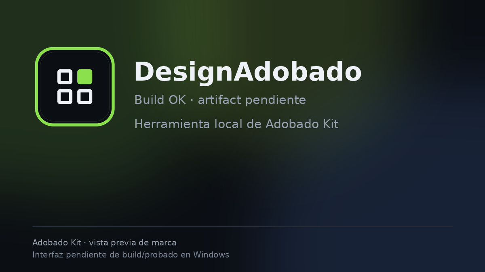

# DesignAdobado

**Diseno y composicion local.** Derivado de DesignCraft, rebrandeado para Adobado Kit.

> **Alpha temprana.** Codigo importado y rebrandeado desde DesignCraft. Build de Windows y prueba de edicion pendientes. No se presenta como app disponible ni como sustituto profesional.
>
> Proyecto independiente. No afiliado a ArtCraft ni a Adobe.

## Estado

- Codigo fuente: importado desde designcraft en el commit 443ea4640ca368fcf0241b04813bd3817acd5df8.
- Rebranding visible: nombre, enlaces, README, avisos y documentacion.
- Pendiente: compilar en Windows, probar abrir/editar/exportar y publicar release.

## Build

Requisitos: Rust 1.95 o superior.

    cargo build --release -p designcraft

El nombre interno del crate se conserva para no romper el workspace; el nombre de producto visible es DesignAdobado.

## Procedencia y licencias

- Upstream: https://github.com/storytold/designcraft
- Commit base: 443ea4640ca368fcf0241b04813bd3817acd5df8
- Licencia: MIT OR Apache-2.0. Se conservan los archivos de licencia, NOTICE y ATTRIBUTION del upstream.
- Cambios: docs/ADOBADO.md.
- La marca, el wordmark y los logos de ArtCraft no estan cubiertos por la licencia y se retiran de la distribucion.

## Adobado Kit

Este repo forma parte de Adobado Kit: https://github.com/smouj/Adobado_Kit

Hecho por SMOUJ013.
